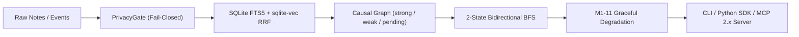

# JVS — Temporal-Causal Knowledge Graph & Cross-Session Causal QA (v2.0)

[English](README.md) | [简体中文](README.zh-CN.md)

[](https://github.com/shenhui-ui/jvs-causal-graph/actions/workflows/ci.yml)  [](LICENSE)

JVS is a lightweight, local-first **temporal-causal knowledge graph** and **cross-session causal QA** engine designed for personal AI agents. Unlike generic RAG or flat agent memory systems, JVS enforces:

1. **Directed Causal Ontology & Confidence Gating**: Events (`subject / action / object / before / after / reason / ts / source_hash`) connected by typed, strength-graded edges (`strong`, `weak`, `pending`). Low-confidence (`<= 0.6`) edges are kept as 1-hop clues (`pending`) and prevented from polluting multi-hop reasoning.
2. **Two-State Causal Traversal**: Separate `clue_seen` and `expanded` state in bidirectional BFS so weak 1-hop clues never block longer strong causal chains.
3. **M1-11 Graceful Degradation**: Automatic classification (`no_chain`, `low_confidence`, `weak_only`) driven by `assets/fallback.yaml`, preventing fabricated causal claims when evidence is thin.
4. **Fail-Closed Outbound Privacy Gate**: Inspects all payloads for known names (NFKC + casefold), credentials, and PII *before* any LLM or embedding call.
5. **Zero External Server Dependencies**: Runs on a single local SQLite file with **FTS5 trigram** full-text search, optional **sqlite-vec** vector search, **NetworkX** structural analytics, **Typer** CLI, and an **MCPServer** (`mcp >= 2.0`).

---

## Architecture



See [docs/ARCHITECTURE.md](docs/ARCHITECTURE.md) for layered dependency boundaries, confidence gating rules, and evaluation guarantees.

---

## Quickstart

### 1. Install

Install via pip (PyPI package name: `jvs-causal-graph`, Python 3.11+):

```bash
pip install jvs-causal-graph
# With sqlite-vec vector search & MCP 2.x Server extras:
pip install "jvs-causal-graph[vec,mcp]"
```

Or install editable from source for local development:

```bash
pip install -e ".[all]"
```

Configure environment variables by copying `.env.example` to `.env`:

```bash
cp .env.example .env
# Set JVS_LLM_PROVIDER (openai | deepseek | doubao | sensenova | ollama | custom)
# and JVS_LLM_API_KEY
```

### 2. 1-Minute Offline Demo (`examples/`)

Run a complete graph ingestion, multi-hop traversal, offline QA, and rule evaluation walkthrough with zero API keys using the sanitized sample dataset in `examples/`:

```bash
jvs graph init --db demo.db
jvs graph ingest --db demo.db --events examples/events.jsonl --edges examples/edges.jsonl
jvs graph stats --db demo.db
jvs graph why EX1 --db demo.db --max-hops 3
jvs qa ask "为什么把数据库连接池从20扩容到60？" --db demo.db --offline
jvs qa run --db demo.db --questions examples/questions.jsonl --out demo_out --offline
jvs eval score --answers demo_out/answers.jsonl --questions demo_out/gold.jsonl
```

### 3. CLI Commands (`jvs`)

```bash
# Inspect graph stats & search (supports read-only legacy SQLite DBs)
jvs graph stats --db jvs_causal.db
jvs graph search "连接池扩容" --db jvs_causal.db --k 5
jvs graph why E1 --db jvs_causal.db --max-hops 3
jvs graph timeline --db jvs_causal.db --subject "连接池配置"

# Ingest raw notes into events + causal edges (LLM + PrivacyGate)
jvs graph ingest-text --db jvs_causal.db --file notes.md --corpus worklog

# Or run deterministic pipeline stages individually
jvs pipeline extract --file notes.md --out events.jsonl
jvs pipeline candidates --events events.jsonl --out pairs.jsonl
jvs pipeline judge-edges --events events.jsonl --candidates pairs.jsonl --out edges.jsonl
jvs graph ingest --db jvs_causal.db --events events.jsonl --edges edges.jsonl

# Single-question QA & batch evaluation
jvs qa ask "为什么扩容连接池？" --db jvs_causal.db
jvs qa ask "为什么扩容连接池？" --db jvs_causal.db --offline
jvs qa run --db jvs_causal.db --questions questions.jsonl --out out/
jvs qa prompt --db jvs_causal.db --questions questions.jsonl --out prompts_out/

# Evaluation & multi-run readout
jvs eval score --answers out/answers.jsonl --questions questions.jsonl
jvs eval judge --answers out/answers.jsonl --questions questions.jsonl --out out/scores.json
jvs eval readout judge-result.e1.md judge-result.e2.md judge-result.e3.md

# Fail-closed privacy & credential scan
jvs privacy scan ./workspace --names names.json

# Start MCP Server (stdio / sse / streamable-http)
jvs mcp serve --db jvs_causal.db
```

### 4. Python SDK (`CausalEngine`)

```python
from jvs import CausalEngine, JVSSettings

with CausalEngine("jvs_causal.db", settings=JVSSettings()) as engine:
    engine.init()
    hits = engine.search("连接池扩容", k=5)
    traversal, assessment = engine.why("E1")
    answer = engine.ask("为什么扩容连接池？", use_llm=False)
```

### 5. MCP Integration (OpenClaw / Claude Code / Cursor / Antigravity)

Register JVS as a local stdio MCP server:

```json
{
  "mcpServers": {
    "jvs-causal-graph": {
      "command": "jvs",
      "args": ["mcp", "serve", "--db", "/path/to/jvs_causal.db"]
    }
  }
}
```

Exposed MCP tools: `causal_search`, `causal_why`, `causal_timeline`, `causal_ask`, `causal_ingest_event`, `causal_link_events`, `causal_graph_stats`, plus resource `jvs://graph/summary`.

---

## Project Layout

```text
jvs-causal-graph/
├── LICENSE                  # MIT License
├── README.md                # English documentation
├── README.zh-CN.md          # Simplified Chinese documentation
├── pyproject.toml           # Package manifest, dependencies, pytest & ruff config
├── .env.example             # Safe configuration template
├── .github/workflows/       # GitHub Actions CI & PyPI OIDC publish workflows
├── assets/                  # Versioned prompts & M1-11 fallback.yaml
├── examples/                # Sanitized runnable sample dataset
├── src/jvs/
│   ├── assets/              # Packaged copy of prompts & fallback.yaml for wheel installs
│   ├── config.py            # pydantic-settings configuration & provider presets
│   ├── domain/              # Pure Pydantic models, causal rules, 2-state BFS, NetworkX analytics
│   ├── infrastructure/      # PrivacyGate, SQLite+FTS5+sqlite-vec store, Hybrid RRF, OpenAI+Tenacity
│   ├── application/         # Extraction, QA orchestration, Evaluation, CausalEngine facade
│   ├── cli/                 # Typer + Rich CLI
│   └── mcp/                 # MCPServer (mcp >= 2.0)
├── tests/                   # Offline pytest suite
├── scripts/
│   └── check.py             # Unified quality gate (ruff + pytest + hygiene)
└── docs/
    └── ARCHITECTURE.md      # Technical architecture & design decisions
```

Run quality checks anytime with:

```bash
python scripts/check.py
```

---

## License

Released under the [MIT License](LICENSE).
